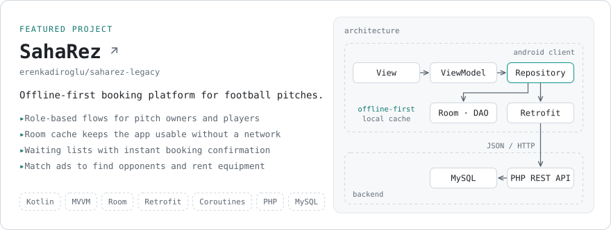
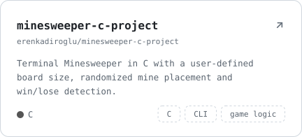
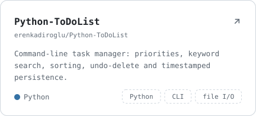
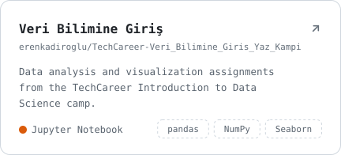
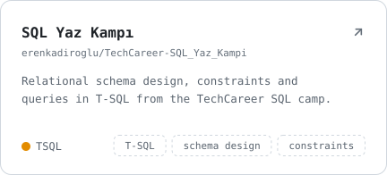

<!--
  Every visual on this page is generated from source in tools/.
  Edit tools/src/content.mjs, then run `npm run build` inside tools/.
-->

<picture>
  <source media="(prefers-color-scheme: dark)" srcset="assets/header-dark.svg">
  
</picture>

  

<a href="https://erenkadiroglu.com"><picture><source media="(prefers-color-scheme: dark)" srcset="assets/links/website-dark.svg"></picture></a>&nbsp;
<a href="https://www.linkedin.com/in/erenkadiroglu"><picture><source media="(prefers-color-scheme: dark)" srcset="assets/links/linkedin-dark.svg"></picture></a>&nbsp;
<a href="mailto:erenkdroglu@gmail.com"><picture><source media="(prefers-color-scheme: dark)" srcset="assets/links/email-dark.svg"></picture></a>&nbsp;
<a href="https://instagram.com/eren_kdroglu"><picture><source media="(prefers-color-scheme: dark)" srcset="assets/links/instagram-dark.svg"></picture></a>

 

## About

I'm a Computer Engineering student at **Kahramanmaraş Sütçü İmam University**, focused on native Android
development and the backends that power it. I like software with a clear architecture — apps that keep working
when the network doesn't, and code the next person can read without a guide.

- **Building** — offline-first Android apps with Kotlin, MVVM, Room and Retrofit
- **Backend** — REST APIs in PHP on top of MySQL
- **Learning** — web fundamentals, from semantic HTML and CSS toward JavaScript
- **Explored** — data analysis with pandas, NumPy and Seaborn, and relational design in T-SQL

## Tech stack

<picture>
  <source media="(prefers-color-scheme: dark)" srcset="assets/stack-dark.svg">
  
</picture>

## Featured project

<a href="https://github.com/erenkadiroglu/saharez-legacy">
  <picture>
    <source media="(prefers-color-scheme: dark)" srcset="assets/projects/saharez-dark.svg">
    
  </picture>
</a>

## More work

<a href="https://github.com/erenkadiroglu/minesweeper-c-project"><picture><source media="(prefers-color-scheme: dark)" srcset="assets/projects/minesweeper-dark.svg"></picture></a>
<a href="https://github.com/erenkadiroglu/Python-ToDoList"><picture><source media="(prefers-color-scheme: dark)" srcset="assets/projects/todo-dark.svg"></picture></a>
<a href="https://github.com/erenkadiroglu/TechCareer-Veri_Bilimine_Giris_Yaz_Kampi"><picture><source media="(prefers-color-scheme: dark)" srcset="assets/projects/datascience-dark.svg"></picture></a>
<a href="https://github.com/erenkadiroglu/TechCareer-SQL_Yaz_Kampi"><picture><source media="(prefers-color-scheme: dark)" srcset="assets/projects/sql-dark.svg"></picture></a>

Also on GitHub: [learn-csharp-by-examples](https://github.com/erenkadiroglu/learn-csharp-by-examples) — C# fundamentals, one concept at a time · [My-Web-Development-Journey](https://github.com/erenkadiroglu/My-Web-Development-Journey) — notes and exercises from my front-end path.

## Activity

<picture>
  <source media="(prefers-color-scheme: dark)" srcset="assets/generated/activity-dark.svg">
  
</picture>

Rendered daily by <a href=".github/workflows/activity.yml">a GitHub Action in this repository</a> from the public GraphQL API — no third-party stats services.

<b>How this profile is built</b>

 

| Piece | Details |
| --- | --- |
| Visuals | Hand-authored SVGs generated by a zero-dependency Node.js script in [`tools/`](tools) |
| Theming | One token set, rendered for GitHub's light and dark themes via `<picture>` |
| Typography | JetBrains Mono, subset and embedded, so cards render identically everywhere |
| Activity | [`activity.yml`](.github/workflows/activity.yml) queries GraphQL daily and commits only when the data changes |
| Quality | [`checks.yml`](.github/workflows/checks.yml) validates every SVG, enforces WCAG AA text contrast and fails on stale assets |

 

Thanks for stopping by — the fastest way to reach me is <a href="mailto:erenkdroglu@gmail.com">email</a>.

