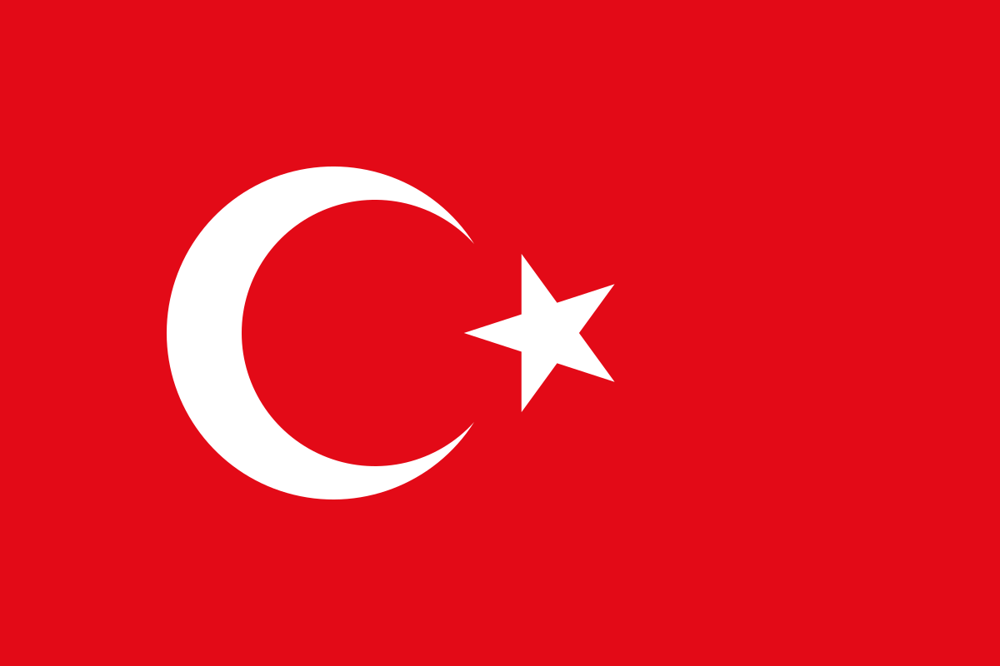

<!--
  Generated by tools/src/readme.mjs — edit tools/src/copy.mjs or readme.mjs, then run `npm run readme` in tools/.
  Visuals: tools/banner/build.py · tools/src/build-static.mjs · .github/workflows/stats.yml
-->

&nbsp; <b>English</b> &nbsp;&nbsp;|&nbsp;&nbsp; <a href="README.tr.md">&nbsp; Türkçe</a>

<picture>
  <source media="(prefers-color-scheme: dark)" srcset="assets/banner-dark.svg">
  
</picture>

 

 

## About

<picture>
  <source media="(prefers-color-scheme: dark)" srcset="assets/about-dark.svg">
  
</picture>

## Featured work

<picture>
  <source media="(prefers-color-scheme: dark)" srcset="assets/project-saharez-dark.svg">
  
</picture>
<picture>
  <source media="(prefers-color-scheme: dark)" srcset="assets/project-fileconvert-dark.svg">
  
</picture>
<picture>
  <source media="(prefers-color-scheme: dark)" srcset="assets/project-pathwords-dark.svg">
  
</picture>

## Experience

<picture>
  <source media="(prefers-color-scheme: dark)" srcset="assets/experience-dark.svg">
  
</picture>

## Tech stack

<picture>
  <source media="(prefers-color-scheme: dark)" srcset="assets/stack-dark.svg">
  
</picture>

## GitHub activity

<picture>
  <source media="(prefers-color-scheme: dark)" srcset="assets/generated/streak-dark.svg">
  
</picture>
<picture>
  <source media="(prefers-color-scheme: dark)" srcset="assets/generated/stats-dark.svg">
  
</picture>
<picture>
  <source media="(prefers-color-scheme: dark)" srcset="assets/generated/langs-dark.svg">
  
</picture>

<picture>
  <source media="(prefers-color-scheme: dark)" srcset="assets/generated/trail-dark.svg">
  
</picture>

<b>Browse by year</b>

<b>2026 · 581 contributions</b>

 

<picture>
  <source media="(prefers-color-scheme: dark)" srcset="assets/generated/trail-2026-dark.svg">
  
</picture>

<b>2025 · 59 contributions</b>

 

<picture>
  <source media="(prefers-color-scheme: dark)" srcset="assets/generated/trail-2025-dark.svg">
  
</picture>

<b>2023 · 1 contribution</b>

 

<picture>
  <source media="(prefers-color-scheme: dark)" srcset="assets/generated/trail-2023-dark.svg">
  
</picture>

 

Cards and calendars are rendered daily by a GitHub Action in this repository from the same contribution graph GitHub shows on the profile — no third-party stats services.

