<!--
  Every visual on this page is generated from source in tools/.
  Banner: tools/banner/build.py · Stack: tools/src/content.mjs · Stats: .github/workflows/stats.yml
-->

<picture>
  <source media="(prefers-color-scheme: dark)" srcset="assets/banner-dark.svg">
  
</picture>

&nbsp;&nbsp;
&nbsp;&nbsp;
&nbsp;&nbsp;

<b>English</b> · <a href="#türkçe">Türkçe</a>

## About

Final-year Computer Engineering student at **Kahramanmaraş Sütçü İmam University**, based in Eskişehir. I build mobile
and web products end to end: React Native apps, React and Next.js frontends, and TypeScript and Python services behind
them. I care about clear architecture, privacy, and software that keeps working when the network doesn't, and I use AI
tooling as an everyday part of my engineering workflow.

Currently open to internships, collaborations and new opportunities.

## Featured work

| Project | What it is | Built with | Status |
| :-- | :-- | :-- | :-- |
| **SahaRez** | Booking and matchmaking platform for sports facilities: a player web app, a facility management panel and an AI service for demand forecasting and price suggestions. Graduation project, piloting in Eskişehir. | NestJS · Next.js · React · FastAPI · PostgreSQL / PostGIS · Redis | `private` · in development |
| **FileConvert** | Free, privacy-first mobile app that converts, merges, edits and compresses PDFs entirely on the device — no server, no account, no tracking. | React Native · Expo · TypeScript · Kotlin native module | `private` · in development |
| **PathWords** | Path-tracing word puzzle that teaches English–Turkish vocabulary, with a procedural generator for endless levels. | React Native · Expo · TypeScript | `private` · in development |
| **[erenkadiroglu.com](https://erenkadiroglu.com)** | Personal portfolio with a JSON-driven content model and an admin panel; static and fast on GitHub Pages. | JavaScript · Node.js · Express | live |
| **[Minesweeper](https://github.com/erenkadiroglu/minesweeper-c-project)** | Console strategy game in C: steer a path across a minefield while tracking each mine's zone of influence. | C | public |

## Experience

| When | Role | Where |
| :-- | :-- | :-- |
| Aug – Sep 2026 | **Software Engineering Intern** — web interfaces, REST API integration and PostgreSQL for the *Eskişehir Encyclopedia* digital library | Anadolu University BAUM · Eskişehir |
| Feb – Apr 2026 | **International Project Management Intern** — led a brand launch end to end, from strategy document to website | TNC Group & Human Ports · Belgrade |
| Jul – Aug 2025 | **IT Intern** — Python task manager and Excel sales dashboards; selected for the Belgrade programme | TNC Group · Remote |

## Tech stack

<picture>
  <source media="(prefers-color-scheme: dark)" srcset="assets/stack-dark.svg">
  
</picture>

## GitHub activity

<picture>
  <source media="(prefers-color-scheme: dark)" srcset="assets/generated/streak-dark.svg">
  
</picture>
<picture>
  <source media="(prefers-color-scheme: dark)" srcset="assets/generated/stats-dark.svg">
  
</picture>
<picture>
  <source media="(prefers-color-scheme: dark)" srcset="assets/generated/langs-dark.svg">
  
</picture>

<picture>
  <source media="(prefers-color-scheme: dark)" srcset="https://raw.githubusercontent.com/erenkadiroglu/erenkadiroglu/output/github-snake-dark.svg">
  
</picture>

Cards are rendered daily by a GitHub Action in this repository straight from the GraphQL API — no third-party stats services.

 

<b>Türkçe</b>

### Hakkımda

**Kahramanmaraş Sütçü İmam Üniversitesi** Bilgisayar Mühendisliği 4. sınıf öğrencisiyim ve Eskişehir'de yaşıyorum.
Mobil ve web ürünlerini uçtan uca geliştiriyorum: React Native uygulamaları, React ve Next.js arayüzleri, bunların
arkasında TypeScript ve Python servisleri. Anlaşılır mimariye, gizliliğe ve ağ olmadığında da çalışmaya devam eden
yazılıma önem veriyorum; yapay zekâ araçlarını mühendislik akışımın günlük bir parçası olarak kullanıyorum.

Staj, iş birliği ve yeni fırsatlara açığım.

### Öne çıkan projeler

| Proje | Nedir? | Teknolojiler | Durum |
| :-- | :-- | :-- | :-- |
| **SahaRez** | Spor tesisleri ile oyuncuları buluşturan rezervasyon ve eşleştirme platformu: oyuncu web sitesi, tesis yönetim paneli, talep tahmini ve fiyat önerisi yapan yapay zekâ servisi. Bitirme projesi, pilot şehir Eskişehir. | NestJS · Next.js · React · FastAPI · PostgreSQL / PostGIS · Redis | `özel` · geliştiriliyor |
| **FileConvert** | PDF'leri cihazdan çıkarmadan dönüştüren, birleştiren, düzenleyen ve sıkıştıran ücretsiz mobil uygulama — sunucu, hesap ve takip yok. | React Native · Expo · TypeScript · Kotlin yerel modül | `özel` · geliştiriliyor |
| **PathWords** | İngilizce–Türkçe kelime öğreten, patika çizmeli kelime bulmacası; sonsuz seviye üreten prosedürel motor. | React Native · Expo · TypeScript | `özel` · geliştiriliyor |
| **[erenkadiroglu.com](https://erenkadiroglu.com)** | İçeriği JSON'dan yönetilen, yönetim panelli kişisel portföy; GitHub Pages'te statik ve hızlı. | JavaScript · Node.js · Express | yayında |
| **[Mayın Tarlası](https://github.com/erenkadiroglu/minesweeper-c-project)** | C ile yazılmış konsol tabanlı strateji oyunu: mayınların etki alanlarını takip ederek tarlada yol bulma. | C | açık kaynak |

### Deneyim

| Dönem | Görev | Kurum |
| :-- | :-- | :-- |
| Ağu – Eyl 2026 | **Yazılım Mühendisliği Stajyeri** — *Eskişehir Ansiklopedisi* dijital kütüphanesinde web arayüzleri, REST API entegrasyonu ve PostgreSQL | Anadolu Üniversitesi BAUM · Eskişehir |
| Şub – Nis 2026 | **Uluslararası Proje Yönetimi Stajyeri** — bir marka lansmanını strateji belgesinden web sitesine kadar uçtan uca yönettim | TNC Group & Human Ports · Belgrad |
| Tem – Ağu 2025 | **Bilgi Teknolojileri Stajyeri** — Python görev yönetimi uygulaması ve Excel satış panoları; Belgrad programına seçildim | TNC Group · Uzaktan |

