<!--
  Generated by tools/src/readme.mjs — edit tools/src/copy.mjs or readme.mjs, then run `npm run readme` in tools/.
  Visuals: tools/banner/build.py · tools/src/build-static.mjs · .github/workflows/stats.yml
-->

<a href="README.md">&nbsp; English</a> &nbsp;&nbsp;|&nbsp;&nbsp; &nbsp; <b>Türkçe</b>

<picture>
  <source media="(prefers-color-scheme: dark)" srcset="assets/banner-dark.tr.svg">
  
</picture>

&nbsp;&nbsp;
&nbsp;&nbsp;
&nbsp;&nbsp;

## Hakkımda

<picture>
  <source media="(prefers-color-scheme: dark)" srcset="assets/about-dark.tr.svg">
  
</picture>

## Öne çıkan projeler

<picture>
  <source media="(prefers-color-scheme: dark)" srcset="assets/projects-dark.tr.svg">
  
</picture>

Bağlantılar: &nbsp;<a href="https://erenkadiroglu.com">erenkadiroglu.com ↗</a> &nbsp;·&nbsp; <a href="https://github.com/erenkadiroglu/minesweeper-c-project">Mayın Tarlası ↗</a>

## Deneyim

<picture>
  <source media="(prefers-color-scheme: dark)" srcset="assets/experience-dark.tr.svg">
  
</picture>

## Teknoloji yığını

<picture>
  <source media="(prefers-color-scheme: dark)" srcset="assets/stack-dark.tr.svg">
  
</picture>

## GitHub aktivitesi

<picture>
  <source media="(prefers-color-scheme: dark)" srcset="assets/generated/streak-dark.tr.svg">
  
</picture>
<picture>
  <source media="(prefers-color-scheme: dark)" srcset="assets/generated/stats-dark.tr.svg">
  
</picture>
<picture>
  <source media="(prefers-color-scheme: dark)" srcset="assets/generated/langs-dark.tr.svg">
  
</picture>

<picture>
  <source media="(prefers-color-scheme: dark)" srcset="assets/generated/trail-dark.tr.svg">
  
</picture>

<b>Yıla göre göz at</b>

<b>2026 · 581 katkı</b>

 

<picture>
  <source media="(prefers-color-scheme: dark)" srcset="assets/generated/trail-2026-dark.tr.svg">
  
</picture>

<b>2025 · 59 katkı</b>

 

<picture>
  <source media="(prefers-color-scheme: dark)" srcset="assets/generated/trail-2025-dark.tr.svg">
  
</picture>

<b>2023 · 1 katkı</b>

 

<picture>
  <source media="(prefers-color-scheme: dark)" srcset="assets/generated/trail-2023-dark.tr.svg">
  
</picture>

 

Kartlar ve takvimler, GitHub'ın profilde gösterdiği katkı grafiğinin aynısından, bu repodaki bir GitHub Action tarafından her gün üretilir; üçüncü parti istatistik servisi kullanılmaz.

