<!--
  Generated by tools/src/readme.mjs — edit tools/src/copy.mjs or readme.mjs, then run `npm run readme` in tools/.
  Visuals: tools/banner/build.py · tools/src/build-static.mjs · .github/workflows/stats.yml
-->

<a href="README.md">&nbsp; English</a> &nbsp;&nbsp;|&nbsp;&nbsp; 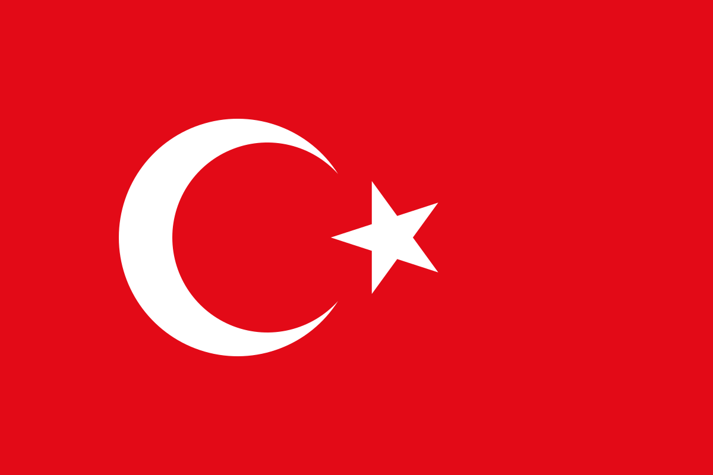&nbsp; <b>Türkçe</b>

<picture>
  <source media="(prefers-color-scheme: dark)" srcset="assets/banner-dark.tr.svg">
  
</picture>

 
<a href="https://www.linkedin.com/in/erenkadiroglu"><picture><source media="(prefers-color-scheme: dark)" srcset="assets/contact-linkedin-dark.tr.svg"></picture></a>
<a href="https://erenkadiroglu.com"><picture><source media="(prefers-color-scheme: dark)" srcset="assets/contact-portfolio-dark.tr.svg"></picture></a>
<a href="mailto:erenkdroglu@gmail.com"><picture><source media="(prefers-color-scheme: dark)" srcset="assets/contact-email-dark.tr.svg"></picture></a>
<a href="https://www.instagram.com/eren_kdroglu"><picture><source media="(prefers-color-scheme: dark)" srcset="assets/contact-instagram-dark.tr.svg"></picture></a>

## Hakkımda

<picture>
  <source media="(prefers-color-scheme: dark)" srcset="assets/about-dark.tr.svg">
  
</picture>

## Öne çıkan projeler

<picture>
  <source media="(prefers-color-scheme: dark)" srcset="assets/project-saharez-dark.tr.svg">
  
</picture>
<picture>
  <source media="(prefers-color-scheme: dark)" srcset="assets/project-fileconvert-dark.tr.svg">
  
</picture>
<picture>
  <source media="(prefers-color-scheme: dark)" srcset="assets/project-pathwords-dark.tr.svg">
  
</picture>

<a href="https://erenkadiroglu.com"><picture><source media="(prefers-color-scheme: dark)" srcset="assets/project-portfolio-dark.tr.svg"></picture></a>
<a href="https://github.com/erenkadiroglu/minesweeper-c-project"><picture><source media="(prefers-color-scheme: dark)" srcset="assets/project-minesweeper-dark.tr.svg"></picture></a>

## Deneyim

<picture>
  <source media="(prefers-color-scheme: dark)" srcset="assets/experience-dark.tr.svg">
  
</picture>

## Teknoloji yığını

<picture>
  <source media="(prefers-color-scheme: dark)" srcset="assets/stack-dark.tr.svg">
  
</picture>

## GitHub aktivitesi

<picture>
  <source media="(prefers-color-scheme: dark)" srcset="assets/generated/streak-dark.tr.svg">
  
</picture>
<picture>
  <source media="(prefers-color-scheme: dark)" srcset="assets/generated/stats-dark.tr.svg">
  
</picture>
<picture>
  <source media="(prefers-color-scheme: dark)" srcset="assets/generated/langs-dark.tr.svg">
  
</picture>

<picture>
  <source media="(prefers-color-scheme: dark)" srcset="assets/generated/trail-dark.tr.svg">
  
</picture>
